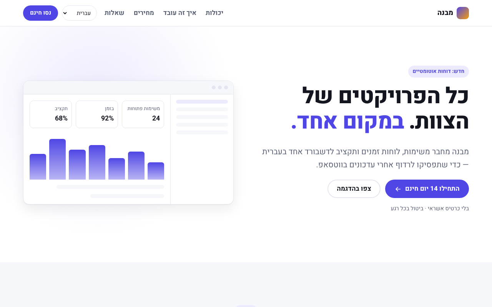

# תכנון פלוס (Tichnun Plus) — Hebrew planning spreadsheets & free calculators

🌐 **Live site: https://tichnun.netlify.app/**

Hebrew Excel / Google Sheets planners and free online calculators for Israeli households and freelancers:

- [מתכנן חתונה באקסל](https://tichnun.netlify.app/p/wedding-planner/) · [מחשבון כמה לשים בחתונה](https://tichnun.netlify.app/tools/wedding-gift/)
- [אקסל תקציב משק בית 2027](https://tichnun.netlify.app/p/household-budget/) · [מחשבון תקציב 50/30/20](https://tichnun.netlify.app/tools/budget-503020/)
- [אקסל לעוסק פטור 2026](https://tichnun.netlify.app/p/osek-patur-tracker/) · [מחשבון תקרת עוסק פטור](https://tichnun.netlify.app/tools/osek-patur-ceiling/) · [מחשבון מע״מ](https://tichnun.netlify.app/tools/vat-calculator/)
- [מתכנן בר/בת מצווה](https://tichnun.netlify.app/p/bar-mitzvah-planner/) · [מחשבון עלות בר מצווה](https://tichnun.netlify.app/tools/bar-mitzvah-cost/)
- [תבניות הצעת מחיר](https://tichnun.netlify.app/p/price-quote-pack/) · [מתכנן תקציב שיפוץ](https://tichnun.netlify.app/p/renovation-budget/) · [מחשבון עלות שיפוץ](https://tichnun.netlify.app/tools/renovation-cost/)
- [כל המדריכים](https://tichnun.netlify.app/guides/)

## Israeli open data (CC0) — holidays 2025–2030, VAT, osek patur, minimum wage

Free JSON + CSV datasets with a source URL for every value: **Israeli holidays 2025–2030** (Hebrew + English names, Hebrew dates,
rest days; computed and cross-checked against two independent libraries), **VAT rate history** since 1976, **osek patur ceiling**
by year, **minimum wage** history and **Bituach Leumi 2026** basics. Zero-dependency JavaScript and Python helpers
(`isIsraeliHoliday`, `addVat`, `removeVat`, `osekPaturCeiling`, `minimumWage`).

- Docs, downloads and examples: [`data-il/`](data-il/) · live page https://tichnun.netlify.app/data-il/
- Python: `pip install "git+https://github.com/eitanco2005-cmd/road-to-glory.git#subdirectory=data-il/python"`
- JS: ``

## Embeddable calculators — add a free Hebrew/English calculator to your site

Copy one snippet and get a responsive, auto-height calculator (under 40KB, no cookies, no ads): כמה לשים בחתונה, מחשבון מע״מ,
תקרת עוסק פטור, תקציב לפי נטו, 50/30/20, סופגניות ולביבות; in English: bar mitzvah gift (chai), bar mitzvah budget, Passover seder
shopping, latkes.

- Hebrew: https://tichnun.netlify.app/embed/ · English: https://tichnun.netlify.app/en/embed/
- Generated from the live calculators by `tools/site/build_embeds.py` (tested by `tools/site/e2e_embed.js`).

## RTL Landing Kit (free, MIT) — RTL landing page templates for Hebrew & Arabic

Open-source **right-to-left landing page templates** built only on CSS logical properties: the same HTML works RTL
(Hebrew, Arabic) and LTR. Plain HTML/CSS plus a Tailwind CSS variant, with a he/ar/en language switcher. No framework.

- Source: [`devkit/`](devkit/) · [README & screenshots](devkit/README.md) · [MIT license](devkit/LICENSE)
- Live demos: https://tichnun.netlify.app/devkit/ · [Download zip](https://tichnun.netlify.app/devkit/rtl-landing-kit-free.zip)
- **Pro pack** (12 more templates + RTL navbars, forms, pricing, dashboards): https://tichnun.netlify.app/devkit/#pro

---
Project docs: `ops/PLAN.md` (master plan), `ops/STATUS.md` (status), `docs/` (site source).
Site base URL and brand live in `tools/site/site_config.py` (`BASE_URL`, `BRAND`) and `docs/assets/config.js` (`SITE_URL`).
To move hosts: `python3 tools/site/set_base_url.py https://new-host/`. Netlify publishes `docs/` at the domain root.
