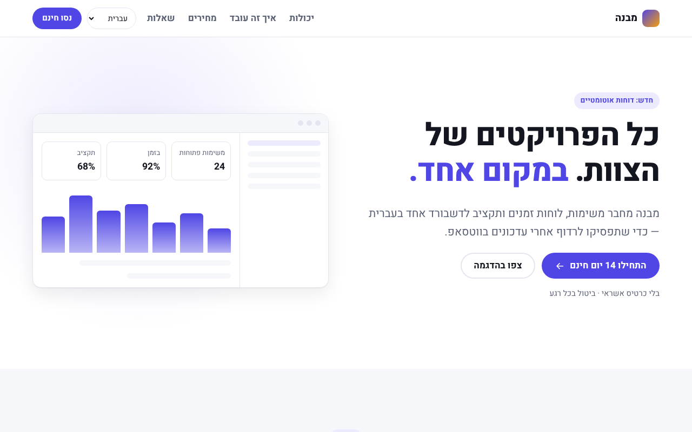
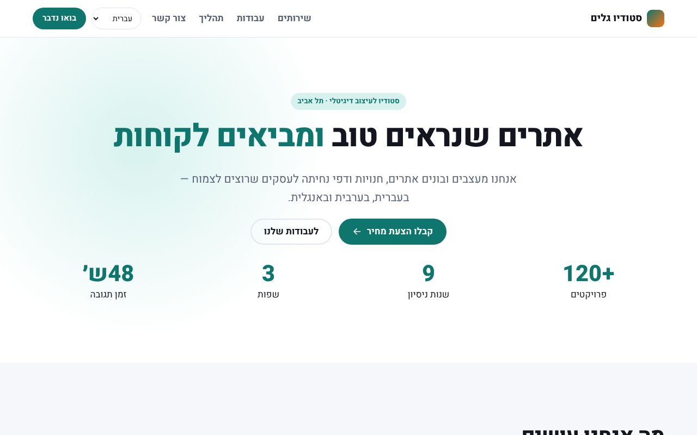
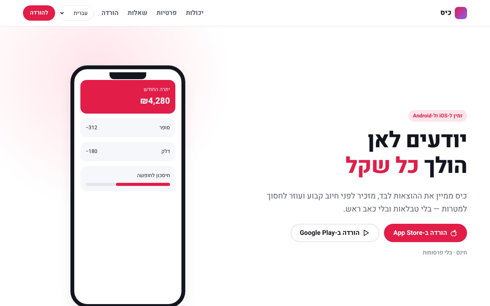
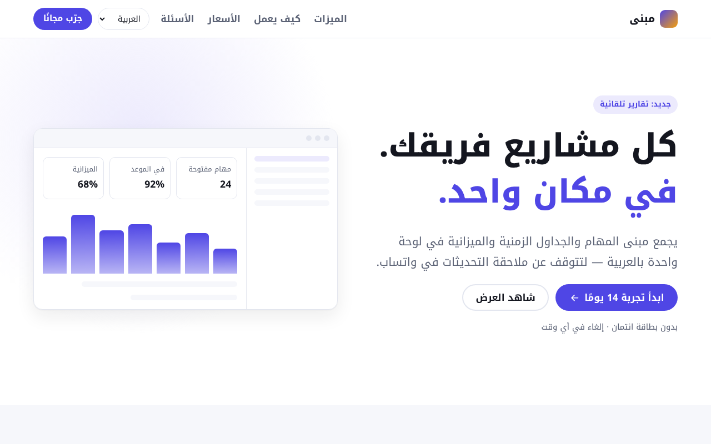
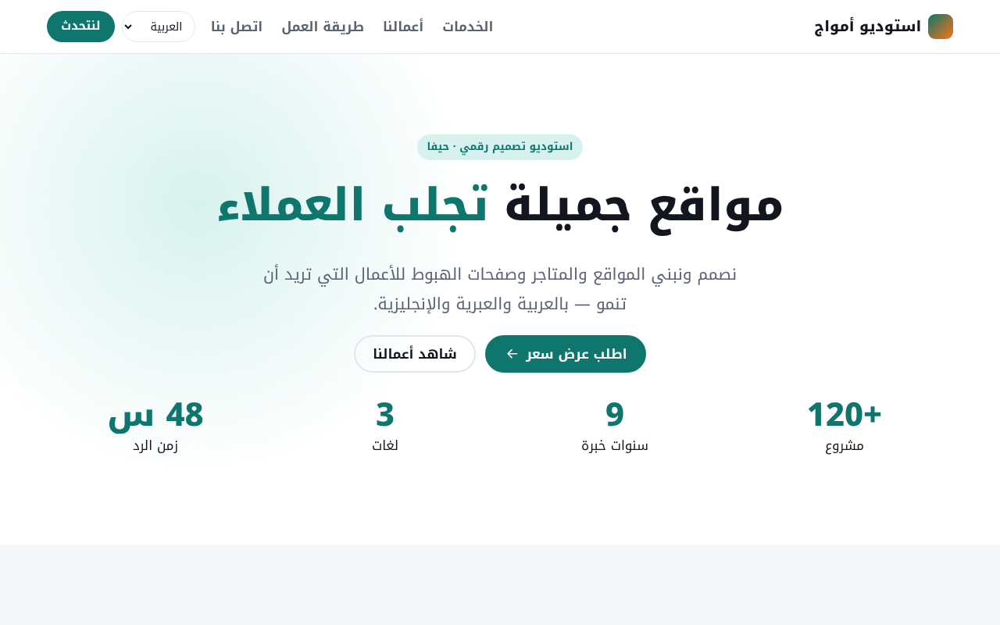
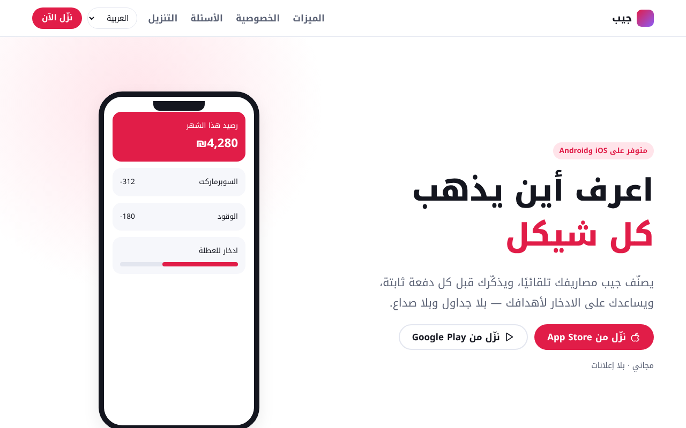
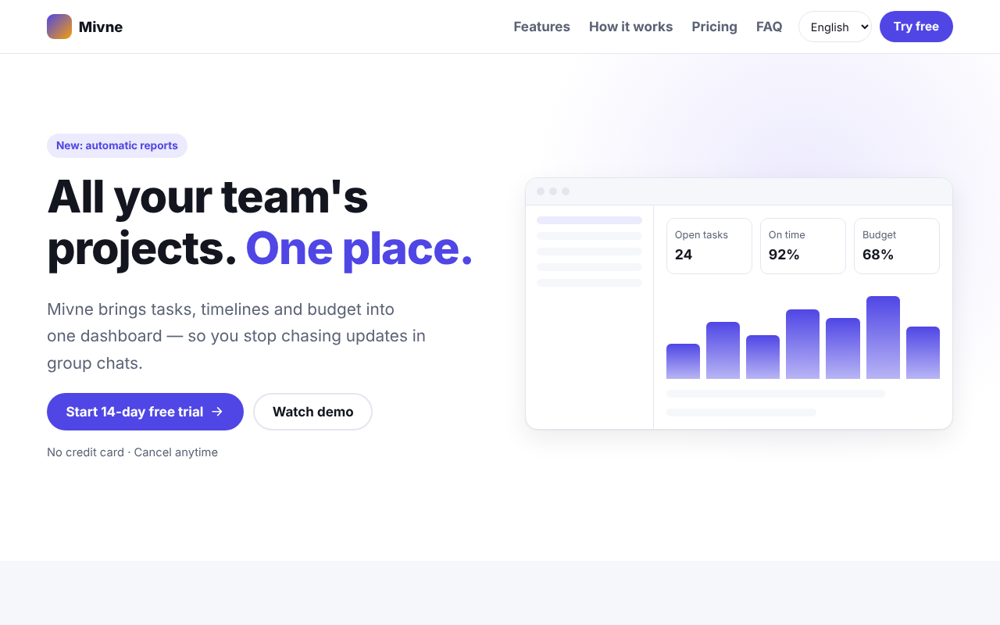
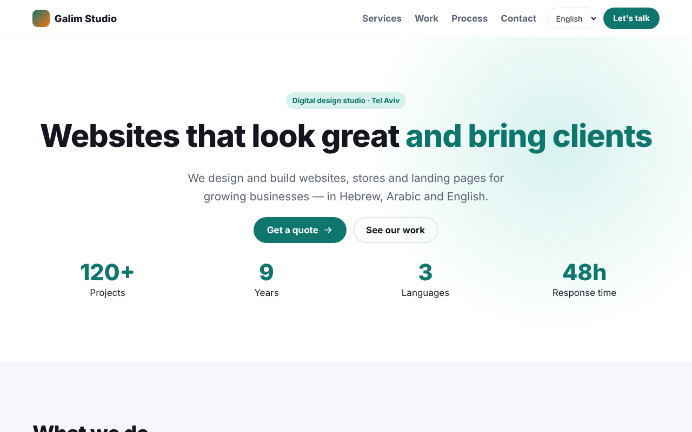
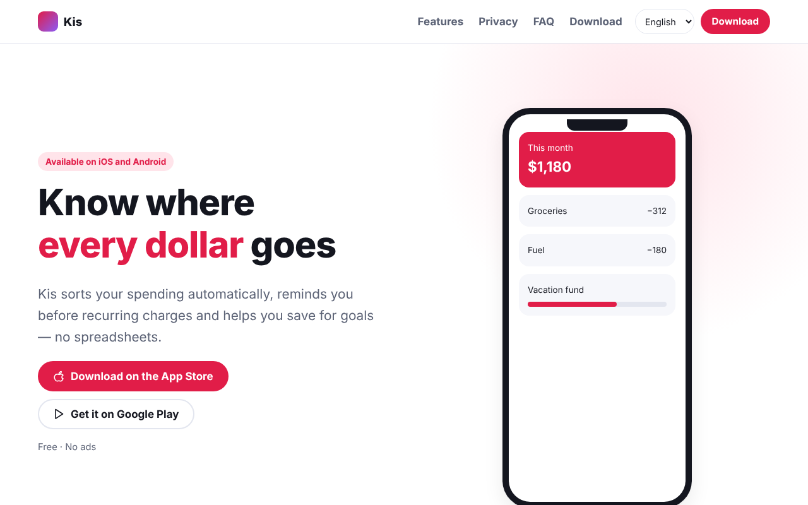

# RTL Landing Kit

**Free, open-source (MIT) landing page templates for right-to-left languages — Hebrew and Arabic — that also work left-to-right.**
Plain HTML + one CSS file built only on CSS logical properties. No framework, no build step. A Tailwind CSS variant of every template is included.

[Live demos](https://tichnun.netlify.app/devkit/) · [Download zip](https://tichnun.netlify.app/devkit/rtl-landing-kit-free.zip) · [Pro pack (12 more templates)](https://tichnun.netlify.app/devkit/#pro)

| Launch (SaaS) | Studio (agency) | Pocket (mobile app) |
|---|---|---|
|  |  |  |
|  |  |  |
|  |  |  |

*Same HTML, same CSS — Hebrew (top), Arabic (middle) and English (bottom). Switch language with the selector in the navbar.*

## Why

Most templates are written for left-to-right and "RTL support" means a second stylesheet full of `left`↔`right` overrides
that breaks the first time someone edits the page. This kit does it the modern way:

- **Logical properties only.** `margin-inline-start`, `padding-inline`, `inset-inline-end`, `border-start-start-radius`,
  `text-align: start`… There is no `left` or `right` anywhere. Flip `<html dir>` and the page mirrors itself.
- **Bidi-safe data.** Prices, phone numbers, emails and URLs sit in `<bdi>` or in `dir="ltr"` inputs aligned to the end,
  so `₪1,250`, `050-000-0000` and `you@example.com` don't scramble inside Hebrew or Arabic sentences.
- **Icons that know their direction.** Arrows get `class="flip"` and mirror in RTL; play/phone icons don't.
- **Real typography per language.** `:lang()` switches fonts — Heebo for Hebrew, Noto Kufi Arabic (with taller line
  height) for Arabic, Inter for Latin.
- **Accessible by default.** Skip link, landmarks, labelled form fields, visible focus, `prefers-reduced-motion`,
  dark mode via `prefers-color-scheme`.
- **Small.** `rtl-kit.css` is ~17 KB unminified; the optional `rtl-kit.js` (language switcher, mobile menu, demo forms) is ~2 KB.

## What's inside

```
templates/
  launch/   index.html (plain CSS) · tailwind.html   SaaS product: hero + dashboard mockup, features, steps, pricing, FAQ, signup
  studio/   index.html · tailwind.html               Agency / freelancer: stats, services, work grid, process, contact form
  pocket/   index.html · tailwind.html               Mobile app: phone mockup, store buttons, features, privacy, FAQ
css/rtl-kit.css     the whole design system (tokens, layout, components) — logical properties only
css/tailwind.css    compiled Tailwind build used by the tailwind.html variants
js/rtl-kit.js       optional: he/ar/en language switcher, mobile menu, demo forms
tailwind/           Tailwind config + input file
tools/              build_free.py + content.py (keeps the three languages in sync; optional)
```

## Quick start

1. [Download the zip](https://tichnun.netlify.app/devkit/rtl-landing-kit-free.zip) or clone this folder.
2. Open `templates/launch/index.html` in a browser. That's it — no install.
3. Edit the text, change the colours in `:root` (`--c-primary`, `--c-accent`…) and deploy anywhere static
   (Netlify, GitHub Pages, Cloudflare Pages, S3).

**One language only?** Delete the `<select data-lang-switch>`, the `<script id="i18n">` block and `rtl-kit.js`, and keep
the text you want in the HTML. For Arabic set `<html lang="ar" dir="rtl">`; for English `<html lang="en" dir="ltr">`.

**Forms** use `data-demo` (they only show a thank-you message). Point them at your backend or a form service and remove the attribute.

### Tailwind variant

`tailwind.html` uses only logical utilities — `ms-*`/`me-*`, `ps-*`/`pe-*`, `start-*`/`end-*`, `text-start`, `border-s`,
`rounded-s` — so one class list works in both directions. After changing classes, rebuild the CSS:

```bash
npm install
npm run build:tw      # tailwindcss 3.4 -> css/tailwind.css
```

## RTL cheat-sheet

| Instead of | Use |
|---|---|
| `margin-left` / `margin-right` | `margin-inline-start` / `margin-inline-end` |
| `padding-left: 1rem; padding-right: 1rem` | `padding-inline: 1rem` |
| `left: 0` | `inset-inline-start: 0` |
| `text-align: left` | `text-align: start` |
| `border-left` | `border-inline-start` |
| `border-top-left-radius` | `border-start-start-radius` |
| `width` / `height` | `inline-size` / `block-size` (optional, but consistent) |
| Tailwind `ml-4` / `pl-4` / `left-0` | `ms-4` / `ps-4` / `start-0` |
| A price inside a sentence | `<bdi>₪1,250</bdi>` |
| Email / phone input | `<input type="email" dir="ltr">` + `text-align: end` |
| Arrow icon | `<svg class="flip">` with `[dir=rtl] .flip { transform: scaleX(-1) }` |

## Pro pack

Need more? **[RTL Landing Kit Pro](https://tichnun.netlify.app/devkit/#pro) — $24, one-time:** 12 more templates
(restaurant, real estate, clinic, law firm, online course, conference, product store, nonprofit, waitlist, portfolio,
fitness studio, SaaS dashboard) plus a components library — RTL navbars with dropdowns and side drawers, multi-step
forms, Israeli checkout/address forms, pricing toggles and comparison tables, dashboard KPI cards, tables and SVG charts.
Same rules, same CSS, no framework. Buying it supports this free kit.

## Browser support

Current Chrome, Edge, Firefox and Safari. (Logical properties have been supported everywhere since 2021.)

## License

[MIT](LICENSE) — use it for anything, including client and commercial work. A link back is appreciated, not required.
Issues and pull requests welcome.
